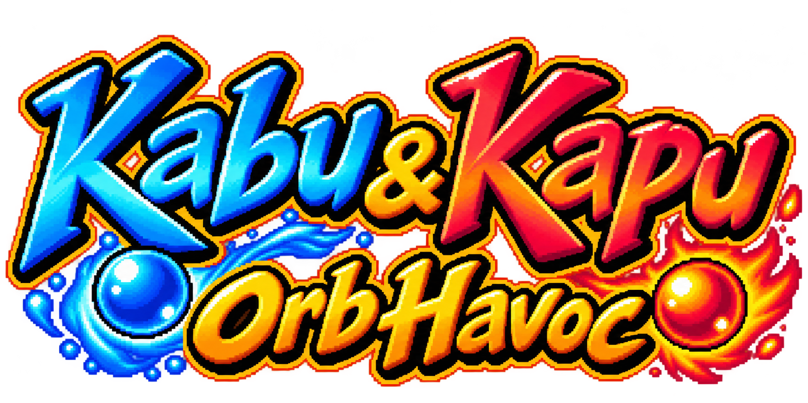
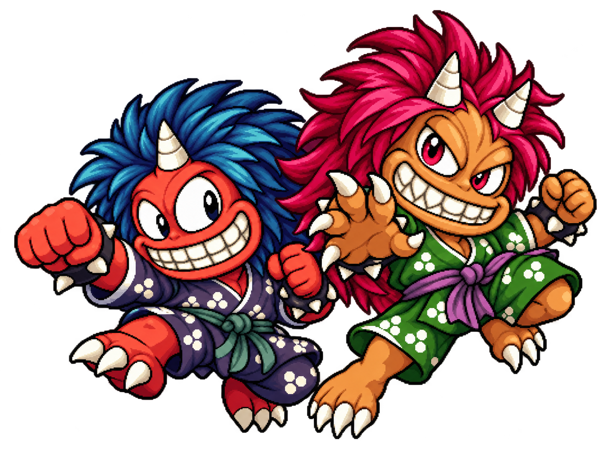
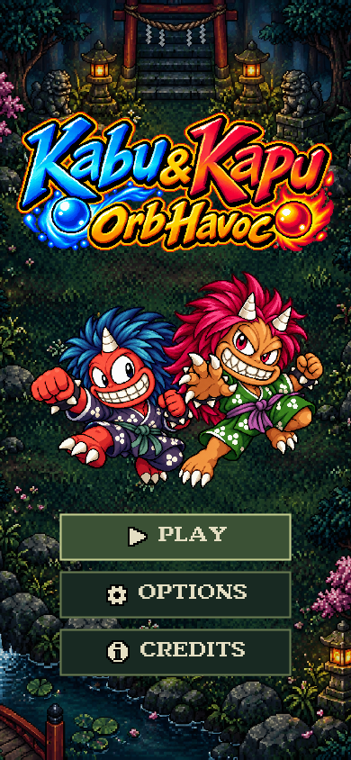
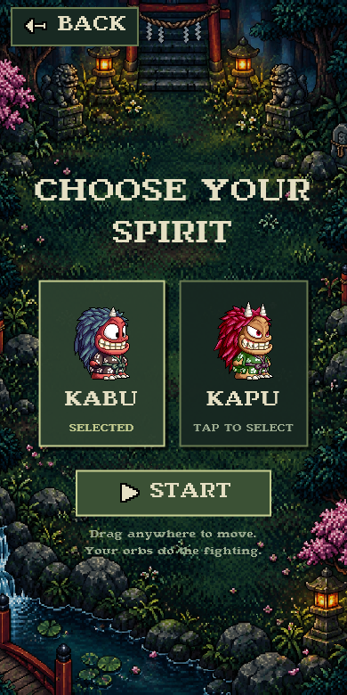
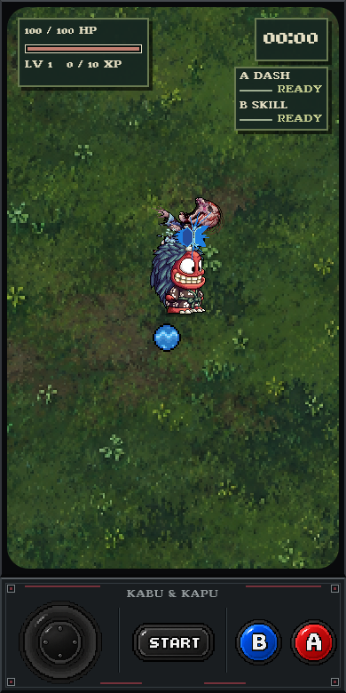
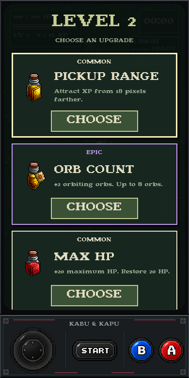
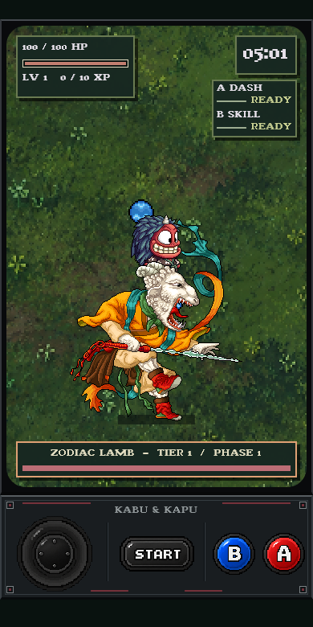

  

  

<h1 align="center">Kabu &amp; Kapu: Orb Havoc</h1>

<strong>Android Demo · Work in Progress</strong>

> 🚧 **DEMO / WORK IN PROGRESS**
>
> Kabu & Kapu: Orb Havoc is still actively being developed. Gameplay, balancing, enemies, bosses, visuals, music, and other content may change.

## 📱 Download the Android Demo

**[⬇ Download Latest Demo](https://github.com/Brentttttttt/Kabu-Kapu-Orb-Havoc/releases)**

Open the latest release and download `Kabu-Kapu-Orb-Havoc-Demo.apk` from its **Assets** section. This is an early Android demo, not a final version. Android may ask you to allow installation from the app you used to download the APK.

## About the Game

**Kabu & Kapu: Orb Havoc** is a retro pixel-art endless survival roguelike. Choose Kabu or Kapu, fight increasingly dangerous creatures, collect upgrades, survive escalating waves, and challenge the Zodiac Lamb throughout an endless run.

## Gameplay Features

- Two playable characters with water and fire combat styles
- Elemental orbs that attack automatically while you move
- Active Dash and projectile barrage abilities
- XP gem pickups, food-based healing, and level-up upgrade choices
- Common, Rare, Epic, and Legendary upgrades, including character-specific choices
- Preta, Poison Hag, Raven, and Pulgasari enemies
- Rising difficulty, recurring boss encounters, and a three-phase Zodiac Lamb fight
- Retro CRT and arcade-inspired presentation with touch controls for Android

## Characters

| Kabu 💧 | Kapu 🔥 |
| --- | --- |
| Water-themed attacks and projectiles | Fire-themed attacks and projectiles |

Both characters have orbiting attacks, Dash, and an active projectile barrage. Their elemental style changes how a run feels.

## Controls

| On-screen control | Action |
| --- | --- |
| Joystick | Move |
| **A** | Dash / dodge |
| **B** | Fire a six-shot projectile barrage |
| **START** | Pause / resume |

Orbiting orbs attack automatically. Collect XP gems to level up, choose upgrades, and pick up food to recover health.
In menus, **A** confirms and **B** goes back.

## Boss and Endless Survival

Enemy pressure increases as a run continues. The **Zodiac Lamb** returns every five minutes and fights through three phases, so surviving one encounter is only the beginning.

## Screenshots

These are captures from the current demo. Visuals may change during development.

| Main Menu | Character Selection |
| :---: | :---: |
|  |  |

| Gameplay | Level-up Upgrades |
| :---: | :---: |
|  |  |

<strong>Zodiac Lamb boss</strong> 
  

## Installation

1. Visit the [Releases page](https://github.com/Brentttttttt/Kabu-Kapu-Orb-Havoc/releases) on your Android device.
2. Download the demo APK from the latest release's **Assets** section.
3. Open the downloaded APK and follow Android's installation prompts. If prompted, allow installation from that download source.
4. Launch **Kabu & Kapu: Orb Havoc**.

Android is the only supported platform for this demo release.

## Development and Technology

Created with **Flutter** and **Dart** for **Android**. This repository is a game showcase and APK download page; the development project is kept private.

For the current demo's changes, see [CHANGELOG.md](CHANGELOG.md). For creator and asset acknowledgments, see [CREDITS.md](CREDITS.md).

## Credits

**Developer and game concept & design:** Brent Bernardo. Kabu & Kapu: Orb Havoc is a personal hobby game project created for fun, creative practice, and personal enjoyment.

Third-party visual, audio, font, and other resources belong to their respective creators and rights holders. The [full credits and non-commercial fan-made disclaimer](CREDITS.md) identify the verified contributors and sources.

## Demo and Development Status

This is a **playable demo / work in progress**. Content and balance are subject to change. The game is an unofficial, non-commercial fan project and is not intended for commercial sale.
